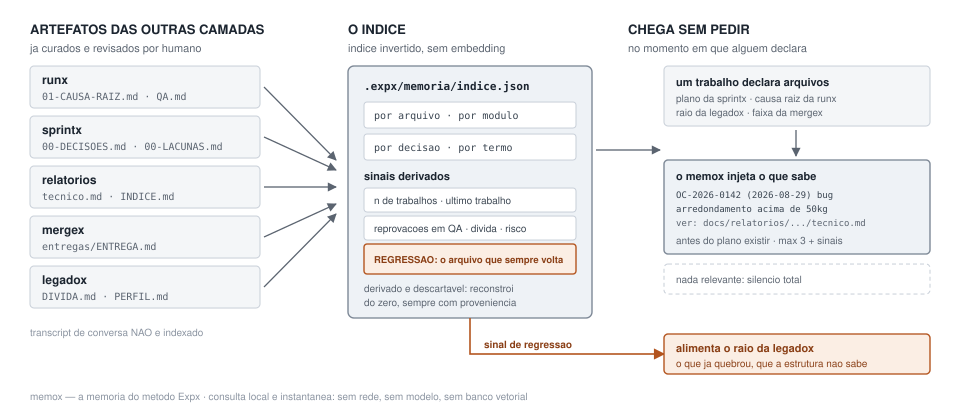

# memox

A camada de memória do ecossistema Expx (Exponencial).

<picture>
  <source media="(prefers-color-scheme: dark)" srcset="assets/memox-fluxo-dark.svg">
  
</picture>

## O problema

Uma software house resolve o mesmo tipo de problema repetidamente. Bug de arredondamento numa faixa de peso hoje; bug parecido no cálculo de comissão em três meses. Quem lembra do primeiro resolve o segundo em vinte minutos. Ninguém lembra.

O conhecimento existe. Está em `01-CAUSA-RAIZ.md`, em `00-DECISOES.md`, em `relatorios/*/tecnico.md`, em `DIVIDA.md`, em `LACUNAS.md` e em `QA.md`. Foi escrito com cuidado, revisado, e está em disco.

O que falta é ele **chegar na hora certa, sem alguém precisar lembrar de procurar**.

Essa é a assimetria que o memox resolve: quem lembra do bug antigo já não precisava da consulta; quem não lembra não sabe que deveria perguntar. Memória que precisa ser consultada não é usada.

## Por que índice, e não RAG

O memox é um **índice invertido**. Não usa embedding, não usa banco vetorial, não resume transcript, não chama modelo para ingerir. A alternativa semântica foi considerada e descartada por três motivos, e eles governam todo o desenho:

1. **A pergunta real não é "o que é semanticamente parecido", é "quem já mexeu neste arquivo e por quê".** Isso é índice invertido, não busca vetorial. A chave de busca é um caminho de arquivo, que é uma string exata.

2. **Resposta de índice é verificável.** Ela aponta arquivo, trabalho e data: dá para abrir o artefato e conferir. Recuperação semântica erra em silêncio — devolve algo plausível, com a mesma confiança com que devolveria o certo.

3. **Índice não custa nada por sessão** e funciona desde o terceiro trabalho fechado. Acervo semântico precisa de volume para valer, e cobra por consulta enquanto não vale.

O memox também **não indexa transcript de conversa**. A fonte são os artefatos, que já foram curados e revisados por humano. Transcript é pensamento em voz alta: contém o caminho descartado com a mesma aparência do caminho adotado — e um índice não tem como distinguir os dois.

## O que é indexado

| Fonte | O que se extrai |
|---|---|
| `docs/relatorios/*/tecnico.md` | trabalho, data de fechamento, tipo, módulo, arquivos alterados, causa em uma linha, risco residual |
| `docs/relatorios/INDICE.md` | a linha do tempo, para ordenação e contagem |
| `docs/manutencao/*/01-CAUSA-RAIZ.md` | modo, se a causa foi comprovada, arquivos impactados, decisões |
| `docs/<slug>/00-DECISOES.md` | cada decisão com a alternativa descartada e o motivo |
| `docs/legado/DIVIDA.md` | dívida observada por arquivo, com risco estimado |
| `base/00-LACUNAS.md` | o que a documentação não respondia |
| `docs/manutencao/*/QA.md` | reprovações — o sinal mais forte de área frágil |
| `docs/entregas/*/ENTREGA.md` | branch, commits e faixa de atenção por arquivo |

O índice tem quatro chaves: **por arquivo**, **por módulo**, **por decisão** e **por termo**.

Toda entrada guarda o caminho do artefato de origem e a data. Nada no índice existe sem apontar para um artefato real — o que torna o índice inteiro descartável e reconstruível do zero a qualquer momento.

## Os sinais derivados

Além de listar, o índice calcula por arquivo e por módulo: quantos trabalhos o tocaram, a data do trabalho mais recente, quantas vezes foi reprovado em QA, se está em zona de risco declarada, se tem dívida registrada, e a faixa de atenção mais frequente nas entregas.

### O sinal de regressão

É o mais valioso e o mais fácil de perder: é o que identifica **o arquivo que "sempre volta"**. Ele alimenta o cálculo de raio da `legadox`, que hoje só enxerga a estrutura do código — quem importa quem, quem chama o quê — e por isso não sabe o que já quebrou.

Dois arquivos com raio estrutural idêntico não têm o mesmo risco se um deles já causou duas regressões e o outro nunca falhou. Essa diferença não está no código; está nos artefatos.

Um trabalho **B** é registrado como regressão de um trabalho **A** apenas quando as três condições valem juntas:

1. um arquivo apontado pela causa raiz de B está entre os arquivos que A alterou;
2. a data de A é estritamente anterior à de B, e as duas datas existem;
3. B tem causa raiz **comprovada** — não análise de impacto, não hipótese.

Faltando qualquer uma, o vínculo é registrado como **coincidência de arquivo**, com o motivo explícito. Dois trabalhos tocando o mesmo arquivo é um fato; dizer que um causou o outro é uma afirmação, e afirmação exige evidência. Um arquivo central é tocado por dezenas de trabalhos sem relação causal entre eles — chamar isso de regressão transformaria o sinal mais valioso do índice em ruído.

Toda regressão registrada carrega os dois caminhos de artefato: o da causa raiz que aponta e o do relatório que alterou. Quem recebe o sinal pode abrir os dois e conferir.

## Controle de ruído

A parte que decide se isso é útil ou irritante. Arquivo muito tocado aparece em dezenas de trabalhos; injetar todos é pior que não injetar nada.

- no máximo **3 entradas recentes** por arquivo;
- **mais**, sempre e independentemente da data, as entradas com **regressão** ou **reprovação em QA** — a idade não as torna irrelevantes;
- acima de **8 entradas relevantes**, o memox não lista: informa a contagem e aponta o índice, deixando o humano decidir se abre.

E, quando não há nada relevante, **silêncio total**: nem uma linha dizendo que não achou. Ruído recorrente treina o time a ignorar, e um bloco que aparece sempre é pulado inteiro — inclusive na vez em que continha o aviso que importava.

Os limites ficam em `.expx/memoria/config.json`.

## Instalação

O memox não tem fluxo próprio: ele produz um índice que as outras skills consultam.

### Claude Code

Copie a skill, os hooks e os comandos para o projeto:

```bash
cp -r .claude/skills/memox    <projeto>/.claude/skills/
cp    .claude/hooks/memox-*.sh <projeto>/.claude/hooks/
cp    .claude/commands/memox*.md <projeto>/.claude/commands/
chmod +x <projeto>/.claude/hooks/memox-*.sh
```

Registre os dois hooks em `.claude/settings.json`:

```json
{
  "hooks": {
    "UserPromptSubmit": [
      { "hooks": [{ "type": "command", "command": "$CLAUDE_PROJECT_DIR/.claude/hooks/memox-injetar.sh" }] }
    ],
    "Stop": [
      { "hooks": [{ "type": "command", "command": "$CLAUDE_PROJECT_DIR/.claude/hooks/memox-reindexar.sh" }] }
    ]
  }
}
```

Construa o índice:

```bash
python3 .claude/skills/memox/assets/memox.py indexar
```

### OpenCode

O OpenCode lê skills de `.claude/skills/*/SKILL.md` nativamente — por isso a skill fica **apenas** em `.claude/skills/`, e não existe `.opencode/skills/`. Nomes de skill precisam ser únicos entre todas as localizações.

```bash
cp -r .claude/skills/memox      <projeto>/.claude/skills/
cp    .opencode/commands/memox*.md <projeto>/.opencode/commands/
```

O `AGENTS.md` na raiz orienta o agente do OpenCode.

**Hooks são mecanismo do Claude Code.** O OpenCode tem sistema próprio de eventos: enquanto não houver equivalente mapeado, isso é **lacuna declarada, não paridade garantida**. Sem hook, o memox continua funcionando por consulta manual — a perda é que alguém precisa lembrar de perguntar, que é justamente o problema que a injeção resolve.

### Comandos

| Comando | O que faz |
|---|---|
| `/memox` | estado do índice: quantos trabalhos, quando foi reconstruído, o que ficou de fora e por quê |
| `/memox-indexar` | reconstrói o índice do zero |
| `/memox-arquivo <caminho>` | o que se sabe sobre um arquivo |
| `/memox-modulo <nome>` | o que se sabe sobre uma área |
| `/memox-buscar <termo>` | busca textual em título, causa e resumo |

Requisito: `python3`. O motor usa apenas a biblioteca padrão — sem dependência externa, sem rede.

## Integração com as outras camadas

Os patches em [`docs/integracao/`](docs/integracao/) são prompts autônomos que alteram cada skill. **Nenhum altera comportamento quando o memox não está instalado.**

| Camada | Onde entra |
|---|---|
| [`sprintx`](docs/integracao/patch-sprintx.md) | consulta na F1 e na F3, sobre os arquivos que o plano pretende tocar |
| [`runx`](docs/integracao/patch-runx.md) | consulta na E1, sobre os arquivos impactados da causa raiz; dispara reindexação na E5 |
| [`legadox`](docs/integracao/patch-legadox.md) | consome regressão e reprovação em QA como entrada do cálculo de raio |
| [`mergex`](docs/integracao/patch-mergex.md) | consulta na classificação de atenção: arquivo com histórico de regressão sobe de faixa |

A integração mais valiosa é a da `sprintx` com as decisões: cada decisão registrada guarda a alternativa que foi descartada e o motivo. Replanejar a alternativa já descartada, sem saber que foi descartada, é o desperdício mais caro e mais silencioso que um time comete.

## O que o memox NÃO faz

- **Não guarda conhecimento próprio.** Toda entrada aponta para um artefato real, com caminho e data. Não há uma "versão do memox" dos fatos que possa divergir dos artefatos e envelhecer em silêncio. Artefato errado se corrige no artefato, e o índice reflete na próxima reconstrução.
- **Não resume conversa.** Transcript não é fonte. O que entra no índice já passou por revisão humana.
- **Não usa embedding.** Sem banco vetorial, sem modelo na ingestão, sem modelo na consulta. Consulta é local e instantânea.
- **Não substitui ler o artefato.** A resposta é um ponteiro — trabalho, data, causa em uma linha e o caminho onde está o detalhe. A linha `ver:` é o produto, não decoração.
- **Não inventa relação.** Coincidência de arquivo não vira regressão por parecer plausível.
- **Não edita artefato.** O memox só lê.
- **Não injeta segredo.** Detectado um segredo num artefato, o trecho é omitido do índice e o artefato é reportado como contaminado.

## Licença

MIT. Ver [LICENSE](LICENSE).
